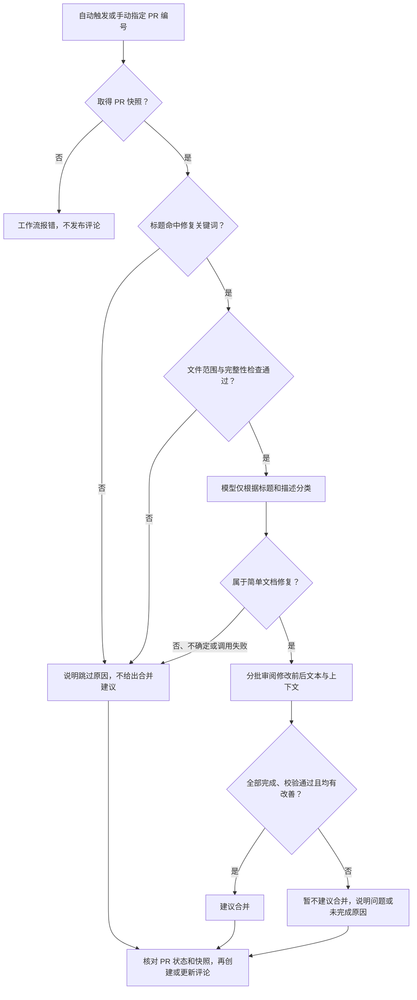

# 文档修复 PR 检查

[文档修复初筛工作流](../../workflows/documentation-repair-screening.yml)先筛选标题，再由 DeepSeek 判断 PR 是否属于简单文档修复、具体修改是否正确，最后发布或更新 PR 评论。程序只给出建议，不自动批准或合并；目前尚未实现完整 PR 分流。

`pr_checker.py` 是判断入口，`src/` 保存实现，`tests/` 保存回归测试和真实 PR 样例。GitHub 交互使用官方 `actions/github-script`；Python 3.13 无需额外运行依赖。

## 工作流做什么

PR 新建、推送提交、重新打开或编辑时自动触发，也可手动指定 PR 编号重审。两种方式都通过 GitHub API 读取 PR 当前的标题、描述和 head/base 提交：



- **标题筛选**：规则见 [src/title_rules.json](src/title_rules.json)，忽略大小写。命中“文档词 + 修复词”或“错别字、拼写、typo”等语言修复词时继续。例如 `docs: 修正链接` 会继续，`fix: 修复登录问题` 会跳过。未命中时不读取文件列表、不调用模型；可按仓库标题习惯调整规则。
- **范围检查**：混合代码修改、整文件新增或删除、重命名、取数不完整的 PR 不进入模型判断。正文按文件列表中的 blob SHA 读取。
- **模型分类**：只接收标题和描述，接受拼写、语法、措辞、排版、简单重复内容删除等低风险候选。涉及技术事实核实或混合修改时，应返回 `other`。关键词命中不等于分类通过。
- **正确性审阅**：分类为 `documentation_repair` 后才逐项检查。全部修改均为 `improved` 且回复校验通过，才建议合并。缺少依据时应返回 `uncertain`；有证据表明生成文档的修改会被覆盖时，应返回 `unchanged`。

评论包含总体结论、审阅总结和默认折叠的详细依据，并注明评估提交。总结复用已有结果，不额外调用模型；未完成审阅时不发布部分依据。

取得快照后，跳过、配置缺失和运行失败也会尝试回复原因。发布前再次核对标题、描述和两侧提交；PR 已关闭、已合并或快照已变化时不发布。同一 PR 的手动和自动运行共用并发组，新运行会取消旧运行。快照读取失败不发评论；文件读取或评论发布失败会令相应步骤失败。

### 范围与限制

| 项目 | 上限或处理方式 |
| --- | --- |
| 文件数量 | 最多 20 个；文件列表只读取首批 100 条，超过 20 个即跳过 |
| 单文件正文、补丁 | 分别不超过 200,000 UTF-8 字节 |
| 单批修改项 | 最多 5 项；不限制整个 PR 的增删行数或修改项总数 |
| 单次模型消息 | 合计不超过 45,000 UTF-8 字节，计入系统提示词、标题、参考材料、JSON 转义及重试提醒预留空间 |
| 输入超限 | 自动拆批；单项仍无法容纳时保留完整原文，继续处理可容纳项，最终以 `model_scope_limit` 标记未完成，不发布部分依据或建议合并 |
| 超时 | 工作流配置网络阻塞超时 60 秒，整个 Python 判断步骤限时 3 分钟；本地调用没有 Actions 步骤限时 |

模型结合上下文和明确可靠的通用知识判断事实性修复，不因缺少参考引用直接拦截；引用了输入参考时，程序会核对引文。GitHub 取数不会自动收集代码参考、访问改动中的链接或执行命令。每批只包含自身改动的上下文和输入参考材料，跨批次关联仍有限。

## 配置

1. 在仓库 **Settings → Secrets and variables → Actions** 设置：

   | 类型 | 名称 | 内容 |
   | --- | --- | --- |
   | Secret（必填） | `DEEPSEEK_API_KEY` | DeepSeek API 密钥 |
   | Variable（可选） | `LLM_MODEL` | 默认 `deepseek-flash` |

2. 允许 Actions 运行及 `pull-requests: write` 权限。工作流、入口和实现需一起部署到默认分支及 PR 的目标分支。
3. 重审旧 PR 时，在 **Actions → 文档修复初筛建议 → Run workflow** 选择含完整实现的可信分支，填写正整数 `pr_number`。默认分支必须先包含手动触发配置，页面才会显示入口。更新审阅程序后，发起新运行即可使用所选分支的新版本。

自动运行使用 PR 目标分支的 base 提交，手动运行使用所选可信分支的提交，均不检出或执行 PR head 代码。GitHub 交互使用工作流令牌，无需安装 `gh` 或配置个人令牌；Python 步骤仅接收模型密钥。

### 模型调用与故障处理

| 配置 | 当前行为 |
| --- | --- |
| 接口 | `https://api.deepseek.com/chat/completions` |
| 请求 | `response_format={"type":"json_object"}`，关闭思考模式，非思考模式传入 `temperature=0` |
| 输出额度 | 工作流 `max_tokens=8192`；本地配置未指定时为 4096 |
| 环境变量 | `LLM_MODEL`、`VALUE_MODEL_API_KEY`；本地可用 `INPUT_MODEL-CONFIG` 指定配置文件 |
| 回复校验 | 只接受 `finish_reason=stop`，再校验 JSON、字段、ID 完整性和引用；[JSON Output](https://api-docs.deepseek.com/guides/json_mode/) 不替代本地校验 |
| 重试 | 分类和每个审阅批次失败后最多重试一次；配置错误不重试 |

`finish_reason=length` 时重发完整请求，输出额度加倍但最多 8192，并要求缩短理由和引文。两次均失败则标记未完成，不把调用失败转换成模型的 `other` 或 `uncertain` 结论。

请求使用 `urllib.request`，不跟随重定向。网络超时并非严格的整次请求截止时间；超过请求或步骤限时的结果按未完成处理。

排查问题时查看 Actions 日志中的阶段、批次、尝试次数和原因码。日志不记录密钥、请求头、PR 正文、模型原始响应或异常正文。

[src/read_pr.cjs](src/read_pr.cjs) 保存输入与快照，[src/comments.py](src/comments.py) 生成评论正文，[src/publish_comment.cjs](src/publish_comment.cjs) 核对快照并维护机器人评论。步骤间通过 runner 临时文件传递数据；Python 失败、超时或未生成正文时使用状态模板。部署后只回复评论，不生成报告、运行摘要或上传附件。

## 提示词和模板

| 文件 | 用途 |
| --- | --- |
| [src/title_rules.json](src/title_rules.json) | GitHub 读取脚本与本地测试共用的标题规则 |
| [prompts/documentation_classification.md](prompts/documentation_classification.md) | 根据标题和描述判断是否属于简单文档修复 |
| [prompts/documentation_repair.md](prompts/documentation_repair.md) | 检查具体修改是否正确 |
| [templates/pr_comment.md](templates/pr_comment.md) | 审阅评论 |
| [templates/pr_status_comment.md](templates/pr_status_comment.md) | 跳过检查或运行失败时的评论 |
| [templates/messages.json](templates/messages.json) | 建议、原因、标签和动态段落格式 |

文件按脚本目录读取 UTF-8 内容，不依赖启动目录或额外模板库。修改模板时保留 `$name` 占位符，字面 `$` 写为 `$$`；PR 原文和模型回复经过转义，只作为数据插入。

Markdown 提示词作为系统消息原样发送，仅去掉末尾换行。修改后需重新调用模型验证效果，离线测试不能替代真实模型验证。新测试记录会保存代码、提示词和模板哈希，不读取历史模型回复来替代调用。

### 模型契约

| 阶段 | 返回内容 |
| --- | --- |
| 分类 | `schemaVersion`、`type`（`documentation_repair`、`other`、`uncertain`）、`reason` |
| 审阅 | `schemaVersion`、`assessments`；每项含 `id`、`type`、`assessment`、`reason`、`references` |

审阅中的 `type` 为 `language` 或 `factual`，`assessment` 为 `improved`、`unchanged`、`harmful` 或 `uncertain`，不再接受旧字段 `kind`、`verdict`。每个修改 ID 必须恰好出现一次；程序补回原始 `before` / `after`，按输入顺序生成 `evidence`。全部批次通过校验才标记完成。

审阅输入按文件组织修改和共享上下文：从完整 head 正文与已校验 diff 还原 base，默认提取两版前后最多 5 行，合并重叠或相邻区间，避免重复发送。标题改动会补充相关标题片段；具体字段和摘录规则见 [src/inspection.py](src/inspection.py)、[src/contexts.py](src/contexts.py)。

## 本地测试

以下命令在本目录执行。完整回归需要 Python 3.13 和 Node.js 22 或以上版本；Python 测试会一并运行 Node.js 内置测试，模拟 GitHub 客户端，无需令牌或联网。真实 PR 样例测试只需 Python。

```sh
# 必要回归测试：模拟接口，不联网、不调用真实模型
python -I -m pip --isolated install -r requirements-dev.txt
python -X utf8 -m unittest discover -s tests -v

# 对 7 个真实 PR 样例做范围检查，不调用模型
python -I tests/real_pr/cann-learning-hub/run.py --output-dir NEW_OFFLINE_DIRECTORY

# 调用 DeepSeek 判断真实样例；会产生 API 费用，只生成本地结果
python -I tests/real_pr/cann-learning-hub/run.py --live --output-dir NEW_LIVE_DIRECTORY
```

输出目录必须是新目录。`--live` 每次重新请求模型，从进程环境或仓库根目录 `.env` 读取 `DEEPSEEK_API_KEY`（也接受 `VALUE_MODEL_API_KEY`），可选读取 `LLM_MODEL`。`.env` 已被 Git 忽略，密钥不打印、不保存。

本地样例测试生成 `report.json` 和使用部署模板的 `.md` 评论预览，不向 GitHub 或 GitCode 发评论。离线模式只验证程序行为，评论会说明模型未配置或预检未通过。直接调用 `pr_checker.py` 时，用 `INPUT_FILES-JSON` 指定输入；未设置 `COMMENT_PATH` 时不写临时评论或步骤输出。

样例来源、预期和历史实测结果见[真实 PR 测试说明](tests/real_pr/cann-learning-hub/README.md)。保留的 `results/` 仅供查阅，当前模型效果需用 `--live` 重新验证。
